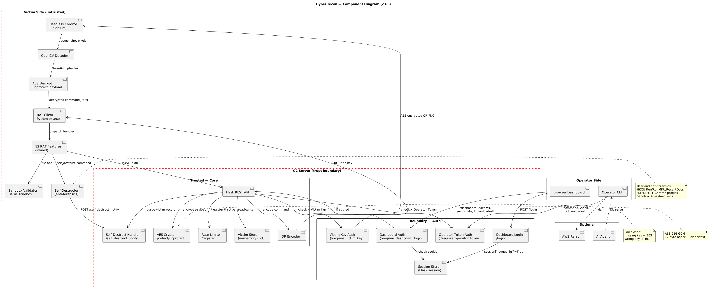

# CyberRecon — Component Diagram (v3.5)

**Format:** PlantUML

**Source file:** [architecture-components.puml](architecture-components.puml)

## Rendered Diagram



## Purpose

Shows the internal component structure of the framework across three zones:

- **Operator side** — browser dashboard, operator CLI, session cookie handling
- **C2 server side** — Flask REST API with auth decorators, QR encoder with AES, in-memory store
- **Victim side** — implant (Python or `.exe`), headless Chrome, OpenCV decoder, inlined RAT features
- **Optional** — AWS Relay, AI Agent

## v3.5 Additions

| Component | Purpose |
|---|---|
| **Session Store** | Flask session (cookie-signed) — holds `logged_in` flag |
| **Dashboard Login Handler** | `/login`, `/logout`, password compare with `secrets.compare_digest` |
| **Victim Key Auth** | `@require_victim_key` decorator on all victim-side routes |
| **Operator Token Auth** | `@require_operator_token` on command-issuing routes |
| **Dashboard Login Auth** | `@require_dashboard_login` on dashboard + read-only APIs |
| **AES Crypto** | `protect_payload` / `unprotect_payload` (AES-256-GCM) |
| **Self-Destruct Orchestrator** | `SelfDestructor` class — registry, temp, sandbox, payload wipe |
| **Sandbox** | `_is_in_sandbox` path validator for file ops |

## PlantUML Source

```plantuml
@startuml
skinparam packageStyle rectangle
skinparam shadowing false
title CyberRecon — Component Diagram (v3.5)

' =====================
' OPERATOR SIDE
' =====================
package "Operator Side" {
    [Browser Dashboard] as DASH
    [Operator CLI] as CLI
}

' =====================
' C2 SERVER (inside trust boundary)
' =====================
package "C2 Server (trust boundary)" #line:red;line.dashed {

    ' Boundary components
    package "Boundary — Auth" as AUTH_PKG {
        [Dashboard Login\n/login] as LOGIN
        [Session Store\n(Flask session)] as SESSION
        [Victim Key Auth\n@require_victim_key] as VKAUTH
        [Operator Token Auth\n@require_operator_token] as OTAUTH
        [Dashboard Auth\n@require_dashboard_login] as DBAUTH
    }

    ' Trusted components
    package "Trusted — Core" as CORE_PKG {
        [Flask REST API] as API
        [QR Encoder] as QR
        [AES Crypto\nprotect/unprotect] as AES
        [Rate Limiter\n/register] as RATE
        [Victim Store\n(in-memory dict)] as STORE
        [Self-Destruct Handler\n/self_destruct_notify] as WIPE
    }
}

' =====================
' VICTIM SIDE (untrusted)
' =====================
package "Victim Side (untrusted)" #line:red;line.dashed {
    [RAT Client\nPython or .exe] as RAT
    [Headless Chrome\n(Selenium)] as BROWSER
    [OpenCV Decoder] as DECODER
    [AES Decrypt\nunprotect_payload] as AESD
    [12 RAT Features\n(inlined)] as MODULES
    [Self-Destructor\n(anti-forensics)] as SDO
    [Sandbox Validator\n_is_in_sandbox] as SANDBOX
}

' =====================
' OPTIONAL
' =====================
package "Optional" {
    [AWS Relay] as RELAY
    [AI Agent] as AI
}

' =====================
' WIRING — Operator side
' =====================

DASH --> LOGIN : POST /login
LOGIN --> SESSION : session["logged_in"]=True
DASH --> DBAUTH : /dashboard, /victims,\n/exfil-data, /download-all
DBAUTH --> SESSION : check cookie
DBAUTH --> API : if authed

CLI --> OTAUTH : /command, /shell,\n/download-all\n(X-Operator-Token)
OTAHUT : placeholder
OTAH --X CLI

' =====================
' WIRING — API layer
' =====================

API --> OTAUTH : check X-Operator-Token
API --> VKAUTH : check X-Victim-Key\non victim routes
API --> RATE : /register throttle
API --> STORE : read/write victim records
API --> QR : encode command
API --> AES : encrypt payload
API --> WIPE : purge victim record

' =====================
' WIRING — Victim side
' =====================

VKAUTH --> RAT : 401 if no key
QR --> BROWSER : AES-encrypted QR PNG\n(via /qr/<id>)
BROWSER --> DECODER : screenshot pixels
DECODER --> AESD : base64 ciphertext
AESD --> RAT : decrypted command JSON
RAT --> MODULES : dispatch handler
MODULES --> SANDBOX : file ops validate path
MODULES --> API : POST /exfil\n(X-Victim-Key)
MODULES --> SDO : self_destruct command
SDO --> WIPE : POST /self_destruct_notify\n(X-Victim-Key)
SDO --> SDO : registry/temp/sandbox wipe\n+ payload self-delete

' =====================
' OPTIONAL wiring
' =====================

CLI ..> RELAY : via (optional proxy)
AI ..> CLI : NL parse

' =====================
' Annotations
' =====================

note right of AUTH_PKG
  All auth checks are
  fail-closed: missing key
  → 503, wrong key → 401
end note

note right of AES
  AES-256-GCM
  12-byte nonce + ciphertext
  base64url encoded
end note

note right of SDO
  Userland anti-forensics:
  - HKCU Run + RunMRU + RecentDocs
  - %TEMP%\\_cr_* + Chrome profiles
  - Sandbox wipe
  - Payload binary deletion
end note

note bottom of STORE
  victims_state.json persisted
  _trim() bounds memory
end note

@enduml
```

## Notes

**Trust boundaries.** The C2 server package is drawn with a red dashed border because it's the trust boundary. Boundary components (auth handlers, rate limiter) sit at the edge; trusted components (QR encoder, AES, store) sit inside.

**Two auth mechanisms on the server side.** Operator auth uses a **session cookie** (set by `/login`) *and* an **operator token** header. Victim auth uses a **shared key** (`X-Victim-Key`). The two are independent — a leaked operator token can't be used without a session, and a leaked session can't queue commands without the token.

**Victim side is untrusted.** Everything inside the victim package could be monitored by EDR. The `X-Victim-Key` header on every call is the only guarantee that exfil is coming from the real implant.

**Inlined RAT features.** The `modules/` directory was removed in v5.0 — all 12 feature handlers now live directly in `rat_client.py` as private methods (`_handle_screenshot`, `_handle_shell`, etc.).