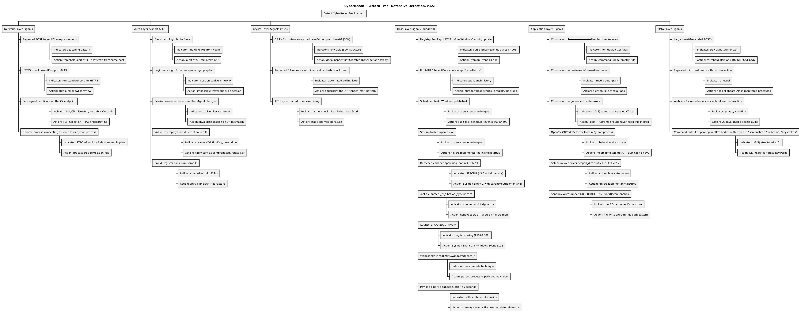

# CyberRecon — Attack Tree (Defensive Detection, v3.5)

**Format:** PlantUML
**Source file:** [attack-tree.puml](attack-tree.puml)

## Rendered Diagram

## Purpose

A defender-oriented attack tree that maps **observable signals** to **defensive actions** for each stage of the CyberRecon kill chain. Organized by layer so a SOC analyst can triage quickly.

## v3.5 Additions

New observable layers added:

- **Auth-layer signals** — dashboard login brute force, session cookie anomalies, victim key replay
- **Crypto-layer signals** — AES-GCM ciphertext in QR PNGs (vs. plaintext base64 JSON)
- **Anti-forensic signals** — detached `cmd.exe` spawning cleanup batch files, HKCU writes just before exit

## PlantUML Source

```plantuml
@startwbs
skinparam monochrome true
title CyberRecon — Attack Tree (Defensive Detection, v3.5)

* Detect CyberRecon Deployment

** Network-Layer Signals
*** Repeated POST to /exfil/* every N seconds
**** Indicator: beaconing pattern
**** Action: threshold alert at 3+ posts/min from same host
*** HTTPS to unknown IP on port 8443
**** Indicator: non-standard port for HTTPS
**** Action: outbound allowlist review
*** Self-signed certificate on the C2 endpoint
**** Indicator: SNI/CN mismatch, no public CA chain
**** Action: TLS inspection + JA3 fingerprinting
*** Chrome process connecting to same IP as Python process
**** Indicator: STRONG — links Selenium and implant
**** Action: process-tree correlation rule

** Auth-Layer Signals (v3.5)
*** Dashboard login brute force
**** Indicator: multiple 401 from /login
**** Action: alert at 5+ failures/min/IP
*** Legitimate login from unexpected geography
**** Indicator: session cookie + new IP
**** Action: impossible-travel check on session
*** Session cookie reuse across User-Agent changes
**** Indicator: cookie hijack attempt
**** Action: invalidate session on UA mismatch
*** Victim key replay from different source IP
**** Indicator: same X-Victim-Key, new origin
**** Action: flag victim as compromised, rotate key
*** Rapid /register calls from same IP
**** Indicator: rate-limit hit (429s)
**** Action: alert + IP block if persistent

** Crypto-Layer Signals (v3.5)
*** QR PNGs contain encrypted base64 (vs. plain base64 JSON)
**** Indicator: no visible JSON structure
**** Action: deep-inspect first QR fetch (baseline for entropy)
*** Repeated QR requests with identical cache-buster format
**** Indicator: automated polling loop
**** Action: fingerprint the `?t=<epoch_ms>` pattern
*** AES key extracted from .exe binary
**** Indicator: strings look like 44-char base64url
**** Action: static-analysis signature for key-shaped strings in compiled payloads

** Host-Layer Signals (Windows)
*** Registry Run key: HKCU\\...\\Run\\WindowsSecurityUpdate
**** Indicator: persistence technique (T1547.001)
**** Action: Sysmon Event 13 rule
*** RunMRU / RecentDocs containing "CyberRecon"
**** Indicator: app launch history
**** Action: hunt for these strings in registry backups
*** Scheduled task: WindowsUpdateTask
**** Indicator: persistence technique
**** Action: audit task scheduler events 4698/4699
*** Startup folder: update.exe
**** Indicator: persistence technique
**** Action: file creation monitoring in shell:startup
*** Detached cmd.exe spawning .bat in %TEMP%
**** Indicator: STRONG (v3.5 anti-forensics)
**** Action: Sysmon Event 1 with parent=python/non-shell
*** .bat file named _cr_*.bat or _cyberrecon*
**** Indicator: cleanup script signature
**** Action: honeypot trap — alert on file creation
*** wevtutil cl Security / System
**** Indicator: log tampering (T1070.001)
**** Action: Sysmon Event 1 + Windows Event 1102
*** svchost.exe in %TEMP%\\WindowsUpdate_*
**** Indicator: masquerade technique
**** Action: parent-process + path anomaly alert
*** Payload binary disappears after <5 seconds
**** Indicator: self-delete anti-forensics
**** Action: memory carve + file create/delete telemetry

** Application-Layer Signals
*** Chrome with --headless=new + --disable-blink-features
**** Indicator: non-default CLI flags
**** Action: command-line telemetry rule
*** Chrome with --use-fake-ui-for-media-stream
**** Indicator: media auto-grant
**** Action: alert on fake-media flags
*** Chrome with --ignore-certificate-errors
**** Indicator: (v3.5) accepts self-signed C2 cert
**** Action: alert — Chrome should never need this in prod
*** OpenCV QRCodeDetector load in Python process
**** Indicator: behavioural anomaly
**** Action: import-time telemetry + EDR hook on cv2
*** Selenium WebDriver scoped_dir* profiles in %TEMP%
**** Indicator: headless automation
**** Action: file creation hunt in %TEMP%
*** Sandbox writes under %USERPROFILE%\\CyberReconSandbox
**** Indicator: (v3.5) app-specific sandbox
**** Action: file-write alert on this path pattern

** Data-Layer Signals
*** Large base64-encoded POSTs
**** Indicator: DLP signature for exfil
**** Action: threshold alert at >100 KB POST body
*** Repeated clipboard reads without user action
**** Indicator: unusual
**** Action: hook clipboard API in monitored processes
*** Webcam / screenshot access without user interaction
**** Indicator: privacy violation
**** Action: OS-level media access audit
*** Command output appearing in HTTP bodies with keys like "screenshot", "webcam", "keystrokes"
**** Indicator: (v3.5) structured exfil
**** Action: DLP regex for these keywords

@endwbs
```

## Reading the tree

Each branch has three levels:

1. **Layer** (Network, Auth, Crypto, Host, Application, Data)
2. **Observable signal** (what a defender can see)
3. **Indicator + Action** (what it means, what to do about it)

Branches tagged **STRONG** are highest-confidence detections — if a defender sees one of these, the host is very likely compromised by CyberRecon specifically (not just "some RAT").

Branches tagged **v3.5** are new detections enabled by the hardening additions (AES, dashboard login, self-destruct orchestrator).

## Notes

**Self-signed cert is a strong tell.** Legitimate services on ports 443/8443 use public CAs. A self-signed cert with CN=cyberrecon.local on an internal host is a near-certain indicator.

**Detached `cmd.exe` spawning from Python** is unusual. The parent process being `python.exe` (or a PyInstaller binary) instead of `explorer.exe` or `services.exe` is the key signal.

**`--ignore-certificate-errors` on Chrome** is almost never used outside of malware and development tooling. Any occurrence in an enterprise endpoint is worth investigating.