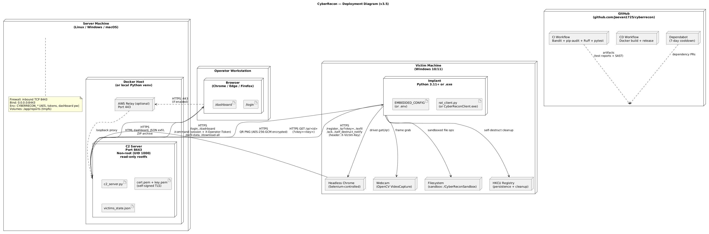
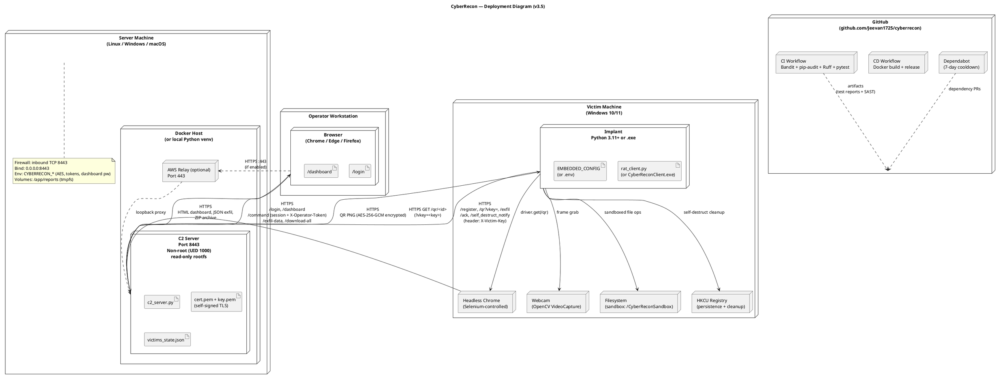

# CyberRecon — Deployment Diagram (v3.5)

**Format:** PlantUML

**Source file:** [deployment.puml](deployment.puml)

## Rendered Diagram

## Purpose

Shows the physical deployment topology for a real two-machine lab demo:

- **Server machine** — runs the C2 (Docker or local Python)
- **Victim machine** — runs the implant (Python or PyInstaller `.exe`)
- **Operator browser** — accesses the dashboard over HTTPS
- **GitHub** — hosts the repo, runs CI/CD

All traffic between server and victim is HTTPS. The self-signed cert requires `CYBERRECON_ALLOW_SELFSIGNED=true` on the client.

## v3.5 Deployment Requirements

| Component | Requirement |
|---|---|
| **Server OS** | Any (Windows / Linux / macOS) — Docker recommended |
| **Server port** | `0.0.0.0:8443` (all interfaces) |
| **Firewall rule** | Inbound TCP 8443 allowed (Windows: `New-NetFirewallRule`) |
| **TLS** | `cert.pem` + `key.pem` in working directory |
| **Client prerequisite** | Google Chrome installed (Selenium fallback exists) |
| **Client sandbox** | `CYBERRECON_SANDBOX` writable (default `~/CyberReconSandbox`) |
| **Network** | Both machines on same LAN / WiFi / hotspot with client-to-client allowed |

## PlantUML Source

## Notes

**Self-signed TLS.** The server auto-generates or detects `cert.pem` + `key.pem`. The client accepts the self-signed cert because `CYBERRECON_ALLOW_SELFSIGNED=true` — which sets both `requests.verify = False` and injects `--ignore-certificate-errors` into headless Chrome.

**Two-machine LAN.** `CYBERRECON_C2` on the client must point at the **server's LAN IP**, not `127.0.0.1`. Firewall must allow inbound TCP 8443.

**Docker hardening.** When deployed via Docker Compose, the container runs read-only with `cap_drop: ALL`, `no-new-privileges`, and non-root UID 1000. Writable paths are mounted as `tmpfs`.

**Sandbox isolation.** All file operations on the victim (`file_download`, `list_files`) validate the requested path against `CYBERRECON_SANDBOX`. Paths outside the sandbox are rejected with an error.

**Anti-forensic cleanup.** On self-destruct, the implant touches `HKCU` (Run key, RunMRU, RecentDocs), `%TEMP%`, Chrome profile directories, the sandbox, and schedules deletion of its own binary via a detached `cmd.exe`.