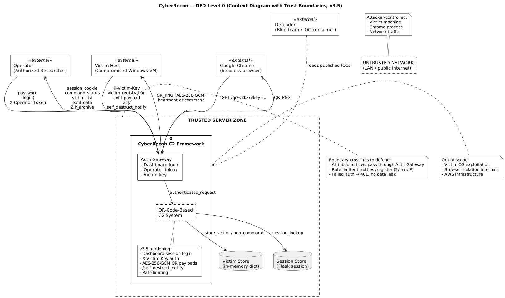
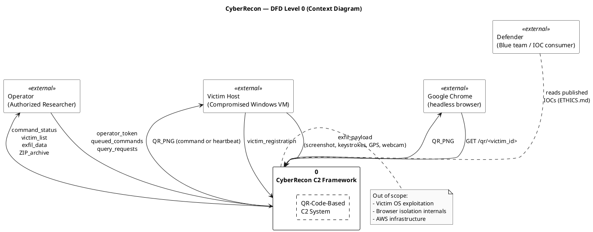

# DFD Level 0 — Context Diagram

**Format:** PlantUML

**Source file:** [dfd-level-0.puml](dfd-level-0.puml)

## Rendered Diagram

## Purpose

The **context diagram** (Level 0) shows the entire CyberRecon system as a
single process bubble, surrounded by the external entities that interact
with it. It defines the **system boundary** — what is inside the system
vs. what is outside.

## External Entities

| # | Entity | Type | Interaction |
|---|--------|------|-------------|
| 1 | **Operator** | Human (authorized researcher) | Sends authenticated commands, reads exfil data, views dashboard |
| 2 | **Victim Host** | System (compromised Windows VM) | Registers with C2, fetches QR-encoded commands, sends exfiltrated data back |
| 3 | **Chrome (headless)** | Process (Selenium) | Requests `/qr/<victim_id>`, renders the returned PNG as pixels |
| 4 | **Defender** | Human (blue team) | Reads published IOCs and detection signatures from ETHICS.md |

## Data Flows

### Inbound to System

| Source | Flow | Description |
|--------|------|-------------|
| Operator | `operator_token`, `queued_commands`, `query_requests` | Authenticated command input |
| Victim Host | `victim_registration` | JSON body sent to `POST /register` |
| Victim Host | `exfil_payload` | Screenshots, keystrokes, GPS, webcam frames |
| Chrome | `GET /qr/<victim_id>` | HTTP request for the QR image |

### Outbound from System

| Destination | Flow | Description |
|-------------|------|-------------|
| Operator | `command_status`, `victim_list`, `exfil_data`, `ZIP_archive` | Dashboard panels + REST responses |
| Victim Host | `QR_PNG` | Base64-JSON command (or heartbeat) encoded as a QR image |
| Chrome | `QR_PNG` | Raw PNG bytes rendered into pixel buffer |

## Scope Notes

**In scope:**
- QR encoding / decoding pipeline
- Victim registration and command queueing
- Exfiltrated data storage and dashboard delivery
- Operator authentication (token-based)

**Out of scope:**
- Victim OS exploitation (assumes already-compromised host)
- Browser isolation internals
- AWS / cloud infrastructure (relay is optional)

## PlantUML Source

## References

- DeMarco, T. (1978). *Structured Analysis and System Specification*
- Gane, C. & Sarson, T. (1979). *Structured Systems Analysis*
- Parent doc: [04-architecture.md](../report/04-architecture.md)