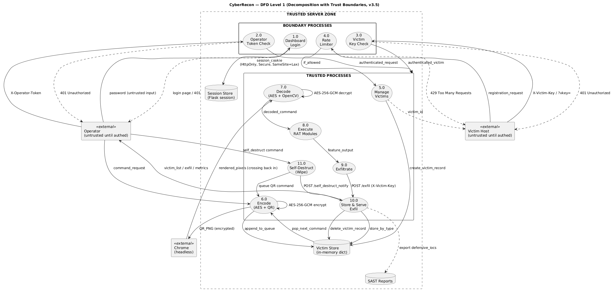
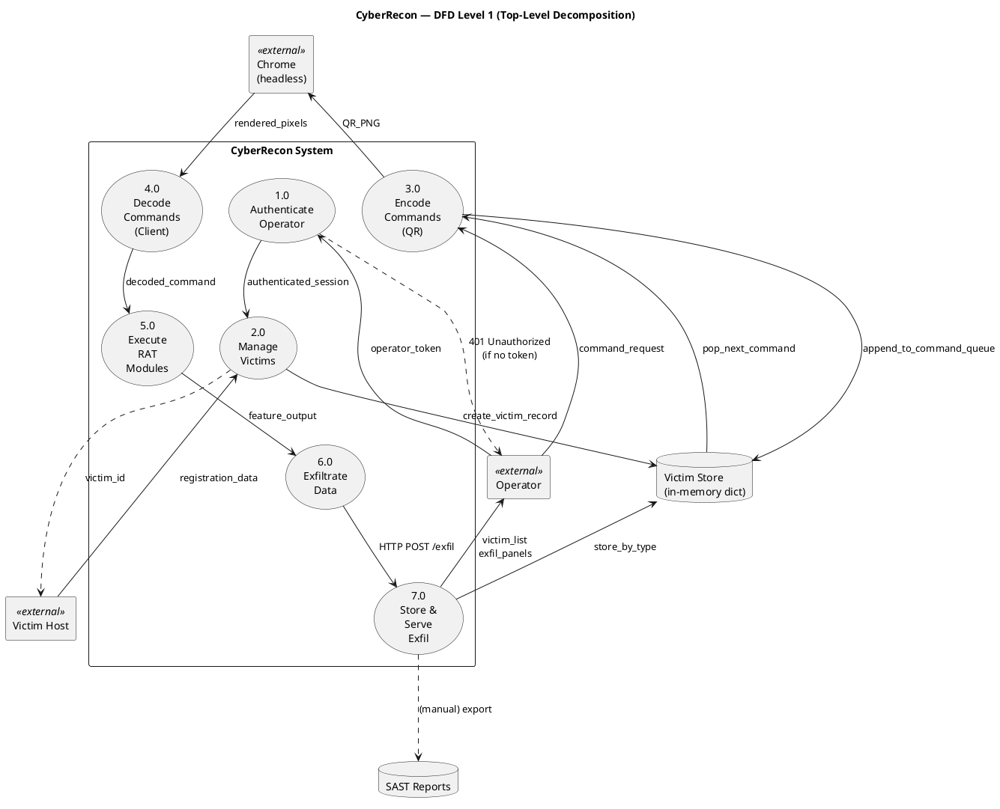

# DFD Level 1 — Top-Level Decomposition

**Format:** PlantUML

**Source file:** [dfd-level-1.puml](dfd-level-1.puml)

## Rendered Diagram

## Purpose

The **Level 1 DFD** explodes Process 0 from Level 0 into **7 major
functional processes**. It reveals the internal structure of CyberRecon
and shows how data flows between processes and data stores.

## Processes

| # | Process | Purpose |
|---|---------|---------|
| **1.0** | Authenticate Operator | Validate `X-Operator-Token` header |
| **2.0** | Manage Victims | Register + track victims |
| **3.0** | Encode Commands (QR) | Serialize command → base64-JSON → QR PNG |
| **4.0** | Decode Commands (Client) | Selenium fetch → OpenCV decode → JSON |
| **5.0** | Execute RAT Modules | Dispatch command to the correct feature handler |
| **6.0** | Exfiltrate Data | POST base64 payload back to C2 |
| **7.0** | Store & Serve Exfil | Persist exfil; serve dashboard + ZIP |

## Data Stores

| Store | Type | Contents |
|-------|------|----------|
| **DS1** | In-memory dict | Victims, command queues, exfil buffers, timestamps |
| **DS2** | File system | SAST evidence reports (Bandit, Semgrep, pip-audit, Ruff) |

## Data Flows (by source)

### From Operator

| Destination | Flow | Description |
|-------------|------|-------------|
| 1.0 Authenticate | `operator_token` | Header `X-Operator-Token` |
| 3.0 Encode QR | `command_request` | Command name + args |
| 7.0 Serve Exfil | (dashboard polling) | Reads `/victims` + `/exfil-data` |

### From Victim Host

| Destination | Flow | Description |
|-------------|------|-------------|
| 2.0 Manage Victims | `registration_data` | JSON `{hostname, os, user}` |
| 4.0 Decode Commands | (via Chrome) | HTTP GET `/qr/<id>` |
| 6.0 Exfiltrate | `exfil_payload` | Base64 data + type |

### From Chrome

| Destination | Flow | Description |
|-------------|------|-------------|
| 4.0 Decode Commands | `rendered_pixels` | Screenshot of the QR-rendered page |

### Between Processes

| From | To | Flow |
|------|----|------|
| 1.0 | 2.0, 3.0, 7.0 | `authenticated_session` |
| 3.0 | Chrome | `QR_PNG` |
| Chrome | 4.0 | `rendered_pixels` |
| 4.0 | 5.0 | `decoded_command` |
| 5.0 | 6.0 | `feature_output` |
| 6.0 | 7.0 | HTTP POST `/exfil/<id>` |

### To / From Data Stores

| Store | Process | Flow |
|-------|---------|------|
| DS1 | 2.0 | `create_victim_record` |
| DS1 | 3.0 | `append_to_command_queue` / `pop_next_command` |
| DS1 | 7.0 | `store_by_type` |
| DS1 | 7.0 | `read_aggregated_data` |
| DS2 | 7.0 | (manual) IOC export |

## PlantUML Source

## Reading Guide

**Start at 1.0 Authenticate** — every operator action passes through this
check first. If the token is missing or invalid, the request is rejected
with HTTP 401 before reaching any downstream process.

**Follow the command loop** — the dashed QR channel (3.0 → Chrome → 4.0)
is the Mandiant technique: commands travel as rendered pixels through a
real browser, not as HTTP requests.

**Exfil returns via 6.0 → 7.0** and lands in the DS1 store, where the
dashboard (also in 7.0) renders it live.

## References

- [04-architecture.md](../report/04-architecture.md)
- [dfd-level-0.md](dfd-level-0.md)
- [dfd-level-2.md](dfd-level-2.md)