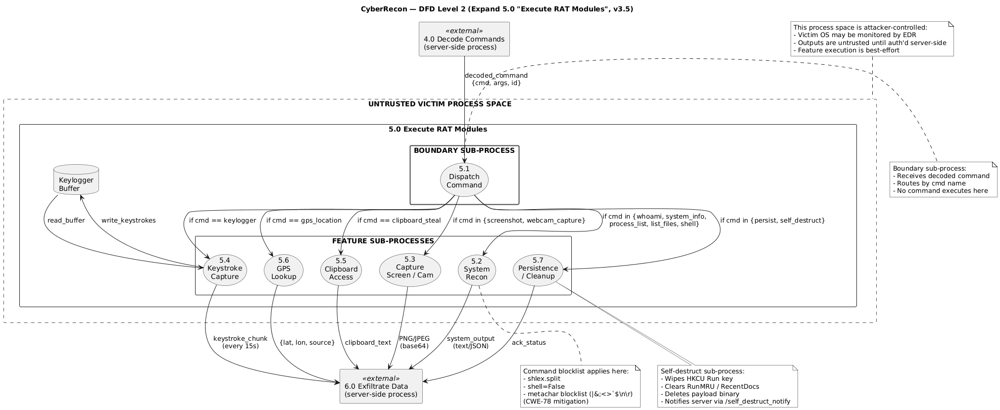
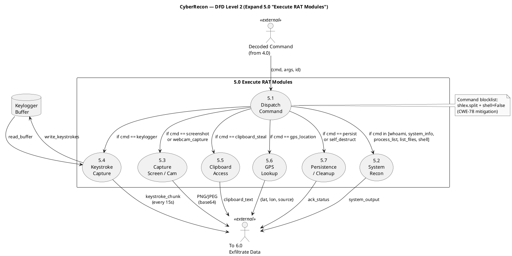

# DFD Level 2 — Expanded Process 5.0 "Execute RAT Modules"

**Format:** PlantUML

**Source file:** [dfd-level-2.puml](dfd-level-2.puml)

## Rendered Diagram

## Purpose

The **Level 2 DFD** explodes Process **5.0 Execute RAT Modules** from
Level 1 into its 7 sub-processes. This is the most complex process in
CyberRecon — it dispatches decoded commands and invokes the correct
feature module.

## Sub-Processes

| # | Sub-process | Trigger commands | Output |
|---|-------------|------------------|--------|
| **5.1** | Dispatch Command | *(all commands)* | Routes to 5.2–5.7 |
| **5.2** | System Recon | `whoami`, `system_info`, `process_list`, `list_files`, `shell` | Text / JSON |
| **5.3** | Capture Screen / Cam | `screenshot`, `webcam_capture` | Base64 PNG / JPEG |
| **5.4** | Keystroke Capture | `keylogger` | Chunked text (every 15s) |
| **5.5** | Clipboard Access | `clipboard_steal` | Plain text |
| **5.6** | GPS Lookup | `gps_location` | `{lat, lon, source}` |
| **5.7** | Persistence / Cleanup | `persist`, `self_destruct` | Ack status |

## Data Stores

| Store | Type | Contents |
|-------|------|----------|
| **KB** | In-memory buffer | Pending keystrokes waiting for the next 15s flush |

## Data Flows

### Inbound

| Source | Flow | Description |
|--------|------|-------------|
| 4.0 Decode Commands (Level 1) | `decoded_command` | `{cmd, args, id}` after QR decode |

### Routing (5.1 Dispatch)

| From | To | Condition |
|------|----|-----------|
| 5.1 | 5.2 | `cmd ∈ {whoami, system_info, process_list, list_files, shell}` |
| 5.1 | 5.3 | `cmd ∈ {screenshot, webcam_capture}` |
| 5.1 | 5.4 | `cmd == keylogger` |
| 5.1 | 5.5 | `cmd == clipboard_steal` |
| 5.1 | 5.6 | `cmd == gps_location` |
| 5.1 | 5.7 | `cmd ∈ {persist, self_destruct}` |

### Outbound

| Source | To | Flow |
|--------|----|------|
| 5.2–5.7 | 6.0 Exfiltrate (Level 1) | `feature_output` (typed base64 payload) |

### Keystroke Buffer Loop

| From | To | Flow |
|------|----|------|
| 5.4 | KB | `write_keystrokes` |
| KB | 5.4 | `read_buffer` (every 15s flush) |
| 5.4 | 6.0 | `keystroke_chunk` |

## Security Note

Sub-process **5.2 (System Recon)** is where the `shell` command executes.
Our Phase 1 patch (CWE-78) uses `shlex.split` + `shell=False` + a shell
metacharacter blocklist before any subprocess call.

## PlantUML Source

## Reading Guide

**5.1 Dispatch** is a **switch** — it inspects the command and routes to
the appropriate sub-process based on the command name.

**5.4 Keystroke Capture** is **stateful** — it writes to the KB store
asynchronously as the user types, and reads back chunks every 15 seconds.

**5.2 System Recon** handles all text-output commands, including the
security-critical `shell` execution path.

## References

- [04-architecture.md](../report/04-architecture.md)
- [dfd-level-0.md](dfd-level-0.md)
- [dfd-level-1.md](dfd-level-1.md)
- [06-threat-model.md](../report/06-threat-model.md) — CWE-78 mitigation