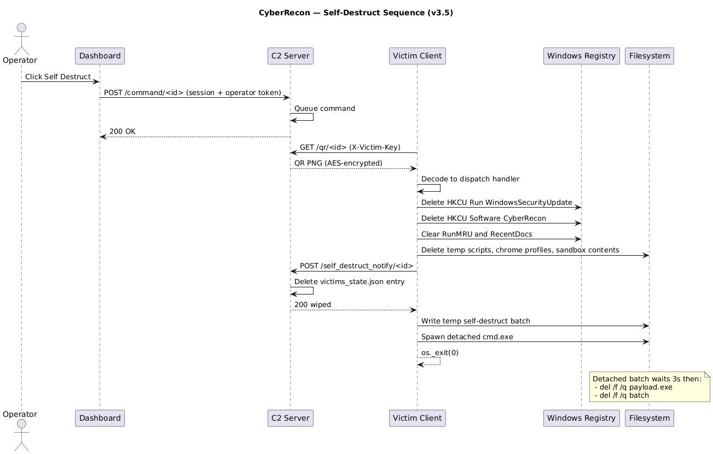
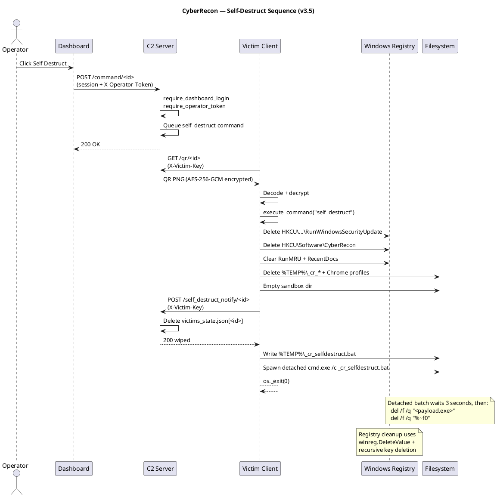

# CyberRecon — Self-Destruct Sequence (v3.5)

**Format:** PlantUML

**Source file:** [self-destruct-sequence.puml](self-destruct-sequence.puml)

## Rendered Diagram

## Purpose

Shows the operator-triggered self-destruct flow that performs userland anti-forensic cleanup on the victim host, notifies the server to purge its record, and deletes the payload binary via a detached `cmd.exe`.

This is the "clean exit" path — it runs when the operator sends the `self_destruct` command from the dashboard, or when a failsafe trigger fires.

## What Gets Cleaned (Userland)

| Target | Contents |
|---|---|
| **Registry** | `HKCU\...\Run\WindowsSecurityUpdate`, `HKCU\Software\CyberRecon`, `App Paths\CyberRecon.exe`, `RunMRU`, `RecentDocs` |
| **Temp files** | `%TEMP%\_cr_*.bat`, `%TEMP%\cyberrecon_chrome_*`, `%TEMP%\scoped_dir*` |
| **AppData** | `%LOCALAPPDATA%\CyberRecon`, `%APPDATA%\CyberRecon` |
| **Sandbox** | `CYBERRECON_SANDBOX` (default `~/CyberReconSandbox`) — all contents |
| **Payload** | The `.exe` or `.py` file, scheduled for deletion 3 seconds after process exit |

## What Cannot Be Cleaned (Documented Limitations)

- NTFS `$MFT` timestamps
- Windows Prefetch (`C:\Windows\Prefetch\CYBERRECON*.pf`) — requires admin
- Sysmon / EDR telemetry (kernel-side)
- Windows Security event log (4688) — requires elevation
- Volatile memory after process exit

These are documented in `docs/report/06-threat-model.md`.

## PlantUML Source

## Notes

**Why the 3-second delay?** Windows cannot delete a running `.exe` — the file lock must be released first. The detached `cmd.exe` sleeps for 3 seconds, then runs the delete while the original process is already gone.

**Server-side wipe.** `/self_destruct_notify/<victim_id>` deletes the victim's entry from `victims_state.json` so the operator can't see it anymore. This is a deliberate design choice — if the operator wants to keep exfil for a report, they should download the ZIP **before** triggering self-destruct.

**Elevated cleanup is opt-in.** Setting `CYBERRECON_ELEVATED_WIPE=1` triggers a UAC prompt on the victim host and attempts to delete Prefetch files + clear Windows event logs. Loud and detectable — off by default.