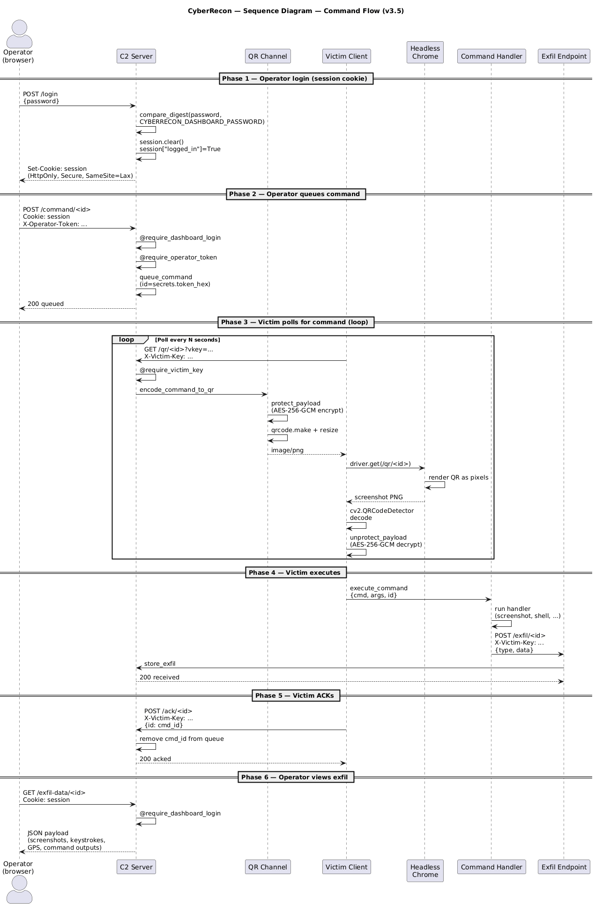
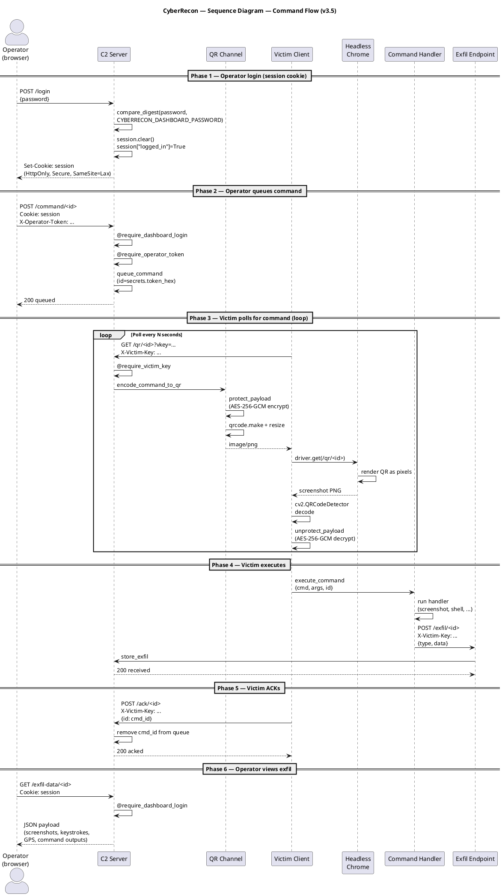

# CyberRecon — Sequence Diagram (Command Flow, v3.5)

**Format:** PlantUML

**Source file:** [sequence-command.puml](sequence-command.puml)

## Rendered Diagram

## Purpose

Shows the complete command-and-control round trip with the v3.5 authentication layers:

1. **Operator login** — session cookie established via `/login`
2. **Command queue** — session + operator token required
3. **Victim poll** — `X-Victim-Key` auth on every victim-side call
4. **AES-256-GCM encryption** — QR payloads are ciphertext on the wire
5. **Command execution** — server-side handler dispatch
6. **Exfil + ACK** — victim confirms execution, server pops command from queue

## Authentication Layers (v3.5)

| Layer | Where | Protects |
|---|---|---|
| **Dashboard session** | `/dashboard`, `/victims`, `/exfil-data`, `/command`, `/shell`, `/download-all` | Unauthenticated reads + command queueing |
| **Operator token** (`X-Operator-Token`) | `/command`, `/shell`, `/download-all` | Session-cookie theft |
| **Victim shared key** (`X-Victim-Key`) | `/register`, `/qr`, `/exfil`, `/ack`, `/self_destruct_notify` | Victim impersonation + exfil spoofing |
| **AES-256-GCM** | QR payload encryption | Passive QR interception |

## PlantUML Source

## Notes

**Session lifetime.** The dashboard session cookie expires after `CYBERRECON_SESSION_HOURS` (default 8). After expiry, the browser is redirected to `/login`.

**Query-param fallback.** Headless Chrome cannot send custom headers on navigation, so `/qr/<victim_id>` also accepts the victim key via `?vkey=<key>`. Both mechanisms are checked by `@require_victim_key`.

**AES-GCM ciphertext.** Every QR now contains `base64(nonce || ciphertext)` instead of `base64(json)`. Without `CYBERRECON_KEY`, the client cannot decrypt and will loop on decode errors.

**ACK semantics.** The server peeks at the queue head (doesn't pop) so a crashed client can retry. The client ACKs after successful execution, and only then is the command removed from the queue.