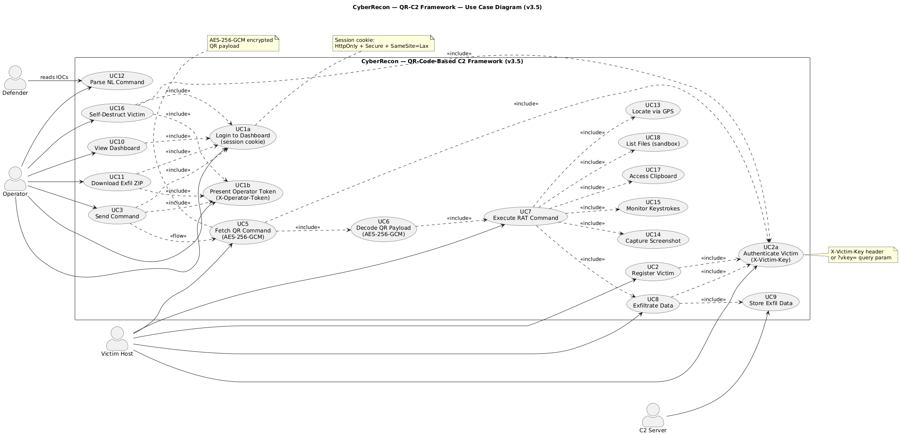
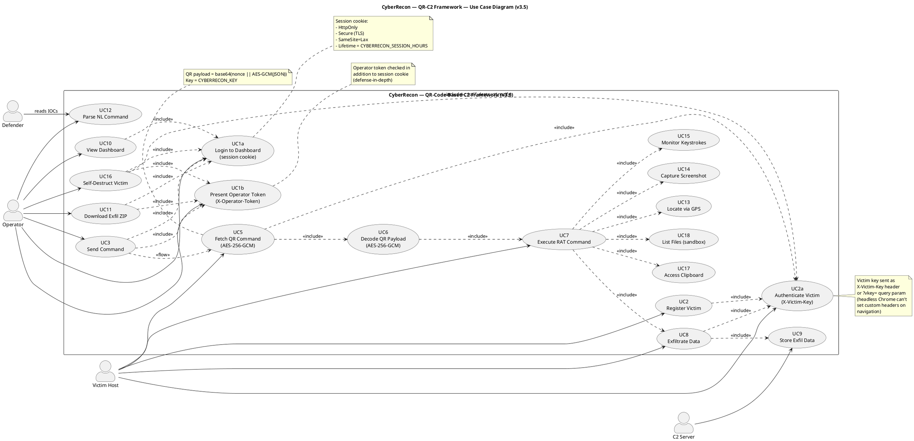

# CyberRecon — Use Case Diagram (v3.5)

**Format:** PlantUML

**Source file:** [use-case.puml](use-case.puml)

## Rendered Diagram

## Purpose

Shows every actor-facing capability of the framework, with the v3.5 authentication layers made explicit:

- **Operator** must log in (session) *and* present the operator token for command-issuing actions
- **Victim Host** must authenticate every call with `X-Victim-Key`
- **Defender** consumes published IOCs (read-only, out-of-band)

## Actors

| Actor | Description | Trust level |
|---|---|---|
| **Operator** | Authorized researcher using the dashboard | Untrusted until logged in + token |
| **Victim Host** | Compromised machine running the implant | Untrusted until `X-Victim-Key` verified |
| **Defender** | Blue-team reader consuming IOCs from ETHICS.md | Read-only |
| **C2 Server** | Internal system actor handling auth + storage | Trusted (in-process) |

## New in v3.5

| Use Case | Description |
|---|---|
| **UC1a — Login to Dashboard** | Sets session cookie (HttpOnly, Secure, SameSite=Lax) |
| **UC1b — Present Operator Token** | Additional auth header on `/command`, `/shell`, `/download-all` |
| **UC2a — Authenticate Victim** | `X-Victim-Key` header or `?vkey=` query on every victim-side route |
| **UC16 — Self-Destruct Victim** | Sends wipe command, notifies server via `/self_destruct_notify` |

## PlantUML Source

## Notes

**Defense in depth.** Command-issuing endpoints require **both** the session cookie (from `/login`) **and** the operator token (`X-Operator-Token`). Either one alone is insufficient — this means a stolen session cookie can't queue commands without the token, and a leaked token can't be used without logging in.

**Victim key persistence.** Every victim-side route (`/register`, `/qr`, `/exfil`, `/ack`, `/self_destruct_notify`) verifies `X-Victim-Key` before processing. `?vkey=` is accepted as a fallback because headless Chrome cannot set custom headers on top-level navigation.

**Read-only defender use case.** `UC12 Parse NL Command` is tagged for the Defender because `ETHICS.md` publishes IOCs that defenders consume. This is out-of-band — no runtime communication with the C2.